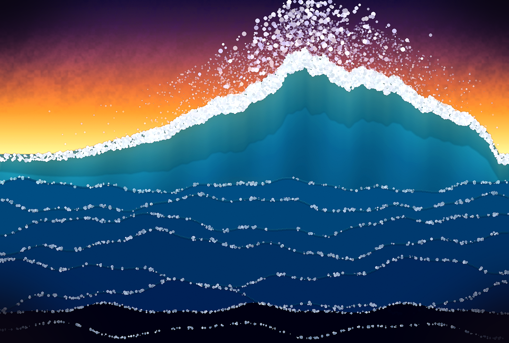

# Ninth Wave

Procedural generation of a painting inspired by Ivan Aivazovsky's *The Ninth Wave* (1850) — using Python, Pillow, and NumPy.



## About

This project creates a digital seascape programmatically, recreating the key compositional elements of Aivazovsky's famous marine painting:

- **Dawn sky** — multi-stop gradient from deep purple to golden horizon with fractal clouds
- **Sun** — layered glow with bright core
- **The ninth wave** — asymmetric crest with foam and spray
- **Ocean layers** — stacked waves with illuminated crests
- **Shipwreck** — broken mast with silhouetted survivors
- **Post-processing** — color grading, oil-paint blending, canvas grain, vignette

## Requirements

- Python 3.9+
- [Pillow](https://python-pillow.org/)
- [NumPy](https://numpy.org/)

## Installation

```bash
git clone https://github.com/akarakuts/ninth-wave.git
cd ninth-wave
pip install -r requirements.txt
```

## Usage

```bash
python3 ninth_wave.py
```

Output is saved to `output/ninth_wave_pil.png` (1600×1080).

Generation takes 10–30 seconds depending on hardware.

## Configuration

Edit the top of `ninth_wave.py`:

| Parameter | Description | Default |
|-----------|-------------|---------|
| `W, H` | Image dimensions | `1600, 1080` |
| `random.seed(...)` | Reproducibility seed | `101` |
| `horizon` | Horizon height (fraction of H) | `H * 0.45` |
| `peak_x` | Wave peak position (fraction of W) | `W * 0.60` |

## How It Works

1. **Sky** — vertical gradient using color stops, blended with fractal Brownian motion (fbm) noise for clouds
2. **Sun** — concentric ellipses with decreasing alpha for radial glow
3. **Sea** — sine-wave composites at multiple frequencies, stacked back-to-front
4. **Main wave** — asymmetric Gaussian profile with multi-octave ripple; solid polygon fill + vertical gradient
5. **Crest glow** — translucent overlay simulating light passing through thin water (Aivazovsky's signature technique)
6. **Foam** — thousands of small ellipses clustered near the wave crest
7. **Post** — enhance contrast/color, blend with blurred copy for "oil paint" effect, add noise grain, apply vignette

## Limitations

This is a **stylized abstraction**, not a photorealistic reproduction. Procedural drawing with PIL has inherent limits:

- No true brush strokes or paint texture
- Wave translucency is simulated with alpha gradients, not physically accurate
- Foam is point-based, not fluid-dynamics based

For photorealistic generation, consider using an AI image generation API (e.g., `qwen-image-3.0-pro`).

## License

[MIT](LICENSE)

## Author

[akarakuts](https://github.com/akarakuts)
